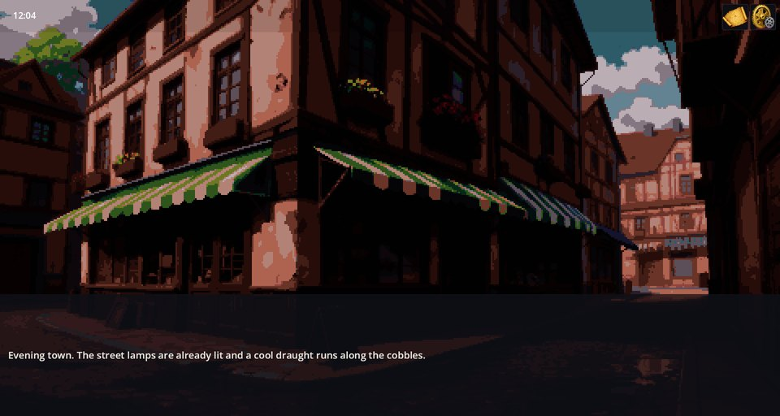
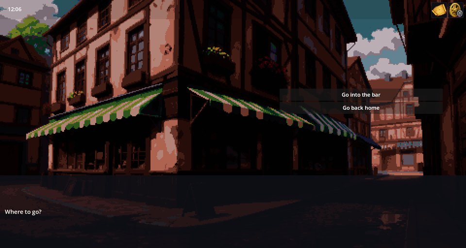
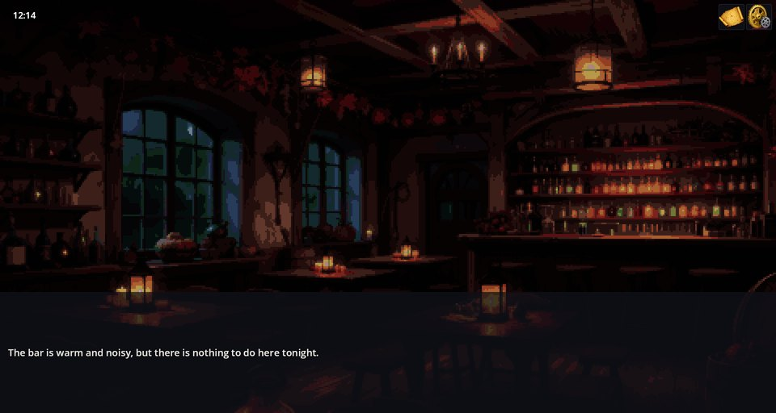

# Dialog Engine — ダイアログボックスとシナリオ言語

Dialog Engine は、プレイヤーが読んでクリックする部分すべてを担います。台詞・ポートレート・選択肢を表示するダイアログボックスであり、その背後には**シナリオ言語**があります。`.scenario` という小さなテキストファイルに物語を一行ずつ書いていく言語で、誰が何を言うか、どんな選択肢があり、それぞれがどこへ続くか、ゲーム内で何が起きるか（背景の切り替え、音楽、アイテム、クエストの進行、別シーンへの移動）をすべて記述します。コレクションに収録されたすべてのゲームが、小説テンプレートから RPG Plus まで、この言語で物語を語ります。

## プレイヤーに見えるもの

シーンに入ると、そのシーンのシナリオは自動的に始まります。台詞が画面下部のボックスに表示され、クリックで次の台詞に進みます。



物語が何かを尋ねるときは、選択肢が右側に現れます。選ばれるまで物語は待ちます。



「バーに入る」を選ぶと、プレイヤーはバーのシーンへ移動し、そこのシナリオが始まります。



## これらの画面の裏にあるシナリオ

小説テンプレートの町のシナリオ全文がこちらです（`my_novel_game/scenarios/my_novel_town.scenario`）。

```scenario
scene: my_novel_town
priority: 10
---
# 町はハブ:訪れるたびに同じ選択肢が表示される。
text "夕暮れの町。街灯はすでにともり、石畳を涼しい風が抜けていく。" key=my_novel/town/intro
select "どこへ行く？" key=my_novel/town/prompt
option "バーに入る" key=my_novel/town/opt_bar -> :bar
option "家に帰る" key=my_novel/town/opt_home -> :home

:bar
switch_scene my_novel_bar
end

:home
switch_scene my_novel_home
end
```

- `---` より上の**ヘッダー**は、シナリオがいつ再生されるかを決めます。`scene:` はシーン名、`priority:` は同じシーンの複数シナリオの順序（小さいほうが先）です。ヘッダー行はこのほかにもあります。
- `text "…"` は台詞を表示してクリックを待ちます。`key=` は台詞の翻訳キーで、引用したテキストは翻訳が見つからないときに表示されます。
- `select` は質問を出し、各 `option` は**ラベル**（`-> :bar`）へ飛ぶ選択肢です。
- `:bar` はラベル、`switch_scene` は別のシーンへの移動、`end` はシナリオの終了です。
- `#` で始まる行は作者向けのメモです。

シーンに物語を追加するには、`.scenario` ファイルを自分の mod の `scenarios/` フォルダーのどこかに置き、ヘッダーでシーン名を指定します。

## 物語を書く

**台詞とポートレート。** `text "…" first=marao/sad` は一つ目の位置にポートレートを表示し、`second=…` は二つ目に表示します（Characters Engine を参照）。`ptext` は `text` と同じ動作に加え、`${name}` を変数の値で置き換えます。`title "…"` は章タイトルを表示します。

**選択肢とジャンプ。** 条件が満たされたときだけ選択肢を表示できます。`option "Pay" "if=item('money/coin') >= 5" -> :pay`（空白を含む条件は `if=` ごと引用符で囲みます）。`goto -> :label` は尋ねずにジャンプします。`when "<condition>" -> :label` は、その時点で条件が満たされていればジャンプします。

```scenario
when "rpg_wolf_dead == 1" -> :lantern
```

**状態の記憶。** `flag rpg_quest_taken 1` は、ゲームのセーブと一緒に保存される物語フラグを立てます。条件では `rpg_quest_taken == 1` と読みます。`set name value` は実行中のダイアログの変数を設定します。`ptext` はこれを `${name}` として表示し、アクションからも読めます。

**条件**は共通の言語です。フラグ、Items Base の `item('id')`、Quests Engine のクエスト判定、各 mod のステータスや装備を、`&&`、`||`、`!` で組み合わせられます。

**シーンの演出。** `background`、`foreground`、`background_color`、`music`、`sound`、`effect`、`delay`、`light_set`、`hide_dialog`/`show_dialog`、`interactive_add`/`interactive_remove`、`notify`。

**ゲームアクション。** `action <name> key=value …` は他の mod のアクションを実行します。例は `action item.add id=money/coin count=3` や `action quest.set_status quest_id=woodland_ward status=Progress` です。アクションの一覧は各 mod のスキーマファイルにあり、Editor Tools のシナリオエディターとコマンドパレットからも入力できます。

## シナリオが再生されるタイミング

決めるのはヘッダーです。

```scenario
scene: prolog_alley
priority: 15
condition: AwakeningQuest.notHasTag("cloak_taken")
is_one_run: true
save_allowed: true
---
```

- `scene:` — プレイヤーが到着したときに再生されるシーン。
- `priority:` — 同じシーンのシナリオ同士の順序。再生できる最小の番号が先になり、ダイアログが終わると次が始まります。
- `condition:` — 条件が満たされている間だけ再生します。フラグやクエストが変わると、シーンは再度判定します。
- `is_one_run: true` — 1 回のゲームで一度だけ再生。
- `after:` — 指定したシナリオが再生されるのを待ちます。
- `save_allowed: true` — このシーンではセーブできます。

`scene:` ヘッダーのないシナリオはシーンからは始まりません。インタラクティブオブジェクトのクリックやマップイベントなど、別のきっかけで実行されます。

## 他の mod による追加と置き換え

すべての mod のシナリオは一つにまとめられます。mod は、シーン名を書くだけで他人のシーンに物語を追加できます。別の mod に依存し、同じファイル名のシナリオを同梱した mod は、それを置き換えます。

## うまく動かないとき

1. **シナリオが再生されない。** `scene:` の名前が違う、`condition` が偽、あるいは `is_one_run` 付きで既に再生済みです。
2. **台詞が別の言語で表示される。** その言語の翻訳キー `key=` が mod の `locale` ファイルになく、引用したテキストがそのまま表示されています。
3. **選択肢がどこにも行かない。** `->` の後のラベルは、同じファイル内にコロン付き（`:bar`）で存在しなければなりません。
4. **`action` が何もしない。** アクションを持つ mod がゲームに含まれていない（ログに "is not registered" と出ます）か、パラメーター名が間違っています。Editor Tools のシナリオエディターで該当アクションと見比べてください。
